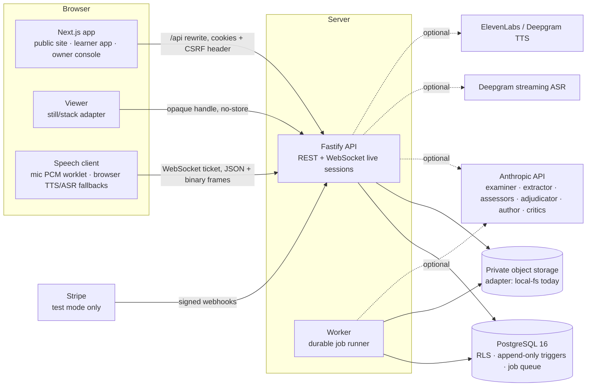
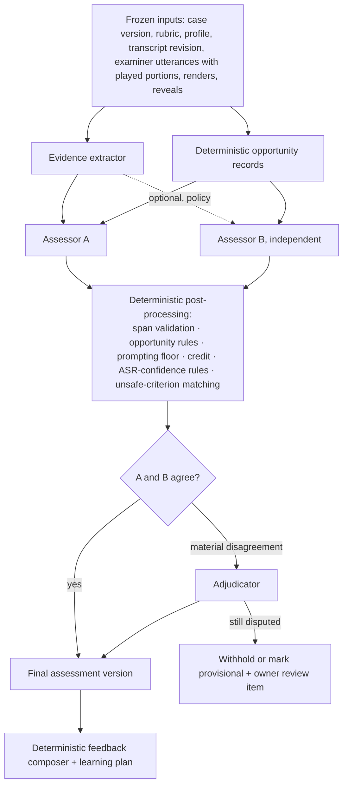

# Architecture

This document describes how the simulator is built, why, and what is still missing. For the API, event and data-model references see [API.md](API.md), [EVENTS.md](EVENTS.md) and [DATA_MODEL.md](DATA_MODEL.md). Current implementation status is in [STATUS.md](STATUS.md).

## 1. Principles

1. **The server owns the examination.** The clock, case order, stage state, allowed actions, media access and usage accounting are held by the API's live-session controller and persisted in PostgreSQL. The browser and the models only propose or render.
2. **Information separation by construction.** Each audience gets an allowlisted projection:
   - the candidate's browser receives opaque media handles and neutral labels;
   - the examiner model receives a per-turn menu of approved actions under one-time aliases;
   - assessors receive the transcript, opportunity records and the approved rubric.

   Hidden answers are never sent to the browser and hidden only by CSS.
3. **Propose, validate, execute.** The examiner model chooses an alias from the menu (`Q1`, `F2`, `R1` and so on). The server validates the alias against the menu it issued and executes only approved text and actions. If the model is slow, refuses, returns invalid output or is switched off, a deterministic policy takes over.
4. **Evidence or nothing.** Every credited or criticized rubric element must cite verbatim, re-validated candidate words. An omission requires a genuine opportunity record. When this cannot be met, the element becomes uncertain or not assessable, never a confident mark.
5. **Versions, not overwrites.** Case versions, profile versions, assessments, transcript revisions, the usage ledger and session events are versioned or append-only.
6. **One human clinical authority.** The owner approves clinical content and resolves exceptions. LLM roles do the faculty work: drafting, examining, assessing, critiquing and checking consistency. Their agreement is never presented as validation.

## 2. Components



| Part | Path | Responsibility |
|---|---|---|
| Web app | `apps/web` | Public pages, sign-in, learner app (setup, preflight, exam room, results, replay, plan, progress, billing, account, appeals), owner console (queue, cases, import, attempts, appeals, coverage, metrics, configuration). Next.js 16 App Router; `/api/*` is rewritten to the API. |
| API | `apps/api` | Auth (local dev or Supabase JWT), owner MFA (TOTP), REST routes via a typed Zod route helper, the WebSocket live-session controller, media authorization, Stripe webhooks and the owner console API. |
| Worker | `apps/worker` | Durable jobs: assessment, debrief and feedback, learning plans, case authoring and critique, privacy exports and deletions, dead-letter handling. |
| Contracts | `packages/contracts` | Zod schemas shared by every service: case contract, profile, session, events, DTOs, WebSocket messages, assessment, feedback, billing, errors. |
| Exam engine | `packages/exam-engine` | Pure logic: lifecycle, clock, stage graph, examiner menu, validation and fallback policy, neutral phrase bank, opportunity computation, prompting classification, form assembly, candidate projections. |
| Clinical content | `packages/clinical-content` | Exam profiles, case validation, content hashing, change classification, publication workflow and gate. |
| AI | `packages/ai` | LLM provider adapter and runner (structured output, retries, kill switches, spend caps, telemetry), the prompt registry, the assessment pipeline, the feedback composer, learning plans, and the speech adapters. |
| DB | `packages/db` | Drizzle schema, SQL migrations (RLS, triggers), durable queue, event append, test-database helpers. |
| Storage | `packages/storage` | Private object storage interface. `LocalFsStorage` and `MemoryStorage` exist; an S3-compatible driver is still to be written. |
| Billing | `packages/billing` | Plans, Stripe event processing, the immutable usage ledger (reserve, release, consume, adjust, expire). |
| Viewer, UI | `packages/viewer`, `packages/ui` | The image viewer used by the exam room, replay and owner preview; shared UI primitives. |
| Fixtures | `fixtures` | Three fictional development cases with labelled placeholder images. Excluded from clinical scores, readiness and production counts. |
| Evals | `evals` | Evaluation harness: response patterns, examiner simulation, regression matrix, locked final split, blind owner ratings, reports. |
| Ingestion | `tools/ingestion` | Python tool for quarantine and de-identification before any external processing. It produces `sim-case-import@1` packages. |

## 3. Live examination flow

```mermaid
sequenceDiagram
  participant B as Browser
  participant A as API (LiveSession)
  participant M as Examiner model
  participant D as PostgreSQL
  B->>A: POST /api/sessions (profile, mode) → form assembled, minutes reserved at start
  B->>A: POST /preflight (mic, speakers, image test) → ready
  B->>A: POST /ws-ticket → single-use ticket
  B->>A: WS hello / start_station
  A->>D: session.started, case.started, usage.reserved (one transaction)
  A->>B: viewer_command (opaque handles, awaitAck)
  B->>A: viewer_ack (rendered | failed)
  A->>B: examiner_utterance (opening question, approved text)
  B->>A: tts_playback started/completed|interrupted(playedChars)
  B->>A: candidate_transcript (server ASR / browser ASR / dev) + end_turn
  A->>M: menu context (aliases only, no clinical truth)
  M-->>A: proposal {action, ref}
  A->>A: validate against issued menu → else deterministic fallback
  A->>D: policy.decision + effects (stage.revealed, examiner.utterance_planned …)
  A->>B: examiner_utterance / viewer_command
  B->>A: request_end_station or clock expiry
  A->>D: case.closed, session.ended, usage.consumed; enqueue assess_case_attempt
```

Key behaviours:

- **Turn-taking.** Ordinary pauses are thinking time. The examiner waits on mid-thought pauses and asks the next approved question only after an explicit end of turn, a completion phrase or extended silence. Decisions requested while the examiner is speaking, or while images await acknowledgement, are deferred, not dropped.
- **Played-portion accounting.** Only what was actually played counts as delivered prompting. The client reports the played portion from provider alignment, the browser's word boundaries, or a proportional estimate rounded down to whole words. An interrupted question below the delivered fraction does not open an opportunity.
- **Unavailable requests.** Requests are answered only through approved fact replies. A request that matches nothing gets a neutral "not available" phrase. No image or result is ever invented.
- **Reconnect.** A WebSocket ticket can reattach to the same in-memory session. The state is re-sent, viewer commands still pending acknowledgement are re-sent, and the clock keeps running inside the grace period. Duplicate commands are discarded by `commandId`.
- **Technical failure.** Render failures are recorded and make the dependent rubric elements not assessable. Long disconnects pause the clock under the profile's technical-pause policy, and beyond the limit the station is invalidated with usage released.

## 4. Assessment pipeline



Details, including statuses, prompting levels, caps and board-specific display, are in [ASSESSMENT.md](ASSESSMENT.md). Without an assessment model, production returns an explicit "assessment unavailable" result. Development may use a clearly labelled lexical baseline, which the API refuses in production.

## 5. Content workflow

`draft → automated_checks → ready_for_owner → owner_approved → published → retired`. Approval binds to the exact clinical content hash. Rights, privacy and external-AI-processing clearances are recorded separately, and publication requires all of them for clinical cases. Any clinical change creates a new version that needs renewed approval; display-only changes keep the approval. Withdrawal stops selection and revokes media access immediately, including replay. See [CASE_AUTHORING.md](CASE_AUTHORING.md).

## 6. Durability and idempotency

- **Events:** `session_events` are appended inside the same transaction as the state change. Each session has a gap-free sequence number, and a trigger makes the table append-only.
- **Jobs:** the queue is a PostgreSQL table with transactional enqueue (outbox semantics), dedupe keys, `FOR UPDATE SKIP LOCKED` claiming, leases, exponential backoff and dead-lettering. A dead job raises an owner review item. Workers wake on `LISTEN/NOTIFY` (`jobs_queued`), with polling as a fallback.
- **Commands:** every client command carries a `commandId`; processed IDs are stored and duplicates ignored.
- **Billing:** Stripe events are deduplicated by event ID and guarded against stale ordering. Usage is an immutable ledger with idempotency keys. Minutes are reserved when a station starts and reconciled exactly once.

## 7. Security and privacy boundaries

- Cookie sessions are `HttpOnly` and `SameSite`. Every mutating request requires the CSRF header `x-sim-csrf`. Owner routes require the owner role and a verified second factor.
- Media is streamed through per-attempt opaque handles (`h_` plus 32 hex characters) with `Cache-Control: private, no-store`. No bucket is public, and withdrawal revokes handles.
- Service credentials stay server-side. The client bundle is scanned by `pnpm check:leaks` for clinical truth, rubric text, canaries, server-only packages and secret names.
- Row-level security is deny-by-default on learner data. Transcript originals, the usage ledger, session events and assessments are protected by triggers. Case attempts cannot be re-pointed to another case version.
- Microphone audio is processed only under consent recorded for the current policy version. Browser speech recognition additionally requires consent to vendor processing.
- External AI processing is per case and off by default. Ingestion quarantines source material and de-identifies it before anything can leave the system. Patient images are never sent to a model just because a key is present.
- Models have no SQL, shell, file, account-administration or billing tools, and no free-form output from them is ever executed.

## 8. Providers and fallbacks

| Role | Real adapter | Verified live? | Fallback |
|---|---|---|---|
| Examiner | Anthropic structured output with server-side fallbacks | No (no key) | Deterministic approved-question policy |
| Evidence extraction, assessors A and B, adjudicator | Anthropic | No | Production: explicit "unavailable". Development: labelled lexical baseline |
| Feedback | Deterministic composer (an optional LLM writer is constrained to rewording only) | n/a | Deterministic composer |
| Case author, critics | Anthropic | No | Owner edits in the structured editor |
| ASR | Deepgram streaming (`nova-3-medical`) with a neuroradiology vocabulary | No | Browser speech recognition (labelled as vendor-processed, consent required), typed input in practice only |
| TTS | ElevenLabs with timestamps, Deepgram Aura | No | Browser speech synthesis (word boundaries), or text only |
| Auth | Supabase JWT (JWKS) | No | Local scrypt accounts, development only (refused in production) |
| Storage | Interface ready | n/a | Local filesystem (single host) |
| Payments | Stripe SDK, test mode | No (no keys) | Checkout disabled with an explicit message |

## 9. Architecture decisions

| # | Decision | Why | Alternatives considered |
|---|---|---|---|
| ADR-1 | A separate Fastify service owns WebSocket live sessions; Next.js serves the UI | Long-lived stateful sockets, binary audio frames and server-owned clocks do not fit serverless request handlers | Next.js route handlers (no durable sockets); a managed realtime service (loses server-side validation of every action) |
| ADR-2 | PostgreSQL is the job queue (outbox semantics) instead of Redis | Enqueue is atomic with the state change; one fewer service to operate; at-least-once delivery with dedupe | Redis/BullMQ (dual writes); SQS (another vendor before the pilot) |
| ADR-3 | Examiner actions are chosen from a per-turn alias menu, validated server-side, with a deterministic fallback | The model cannot invent IDs, text or stages, and the exam stays usable without a model | Model function calls with raw IDs (forgeable); free-text examiner (leakage risk) |
| ADR-4 | Zod contracts shared by every service | One source of truth for allowlisted DTOs, validation and the OpenAPI document | Hand-written types (drift) |
| ADR-5 | Opportunity records are computed deterministically from durable events | Omissions are only charged when the candidate genuinely had the chance; the model cannot assert opportunities | Asking the assessor model (unverifiable) |
| ADR-6 | Evidence spans are re-validated and positive claims without verifiable quotes are downgraded | Prevents fabricated quotes and unsupported marks | Trusting model output |
| ADR-7 | Two independent assessor passes by default; reduced coverage needs explicit owner acknowledgement | Disagreement detection is the main automatic safety net with one human reviewer | A single pass (cheaper, blind to disagreement) |
| ADR-8 | Still/stack image adapter first; Cornerstone3D only for validated de-identified DICOM | No suitable DICOM exists yet; still frames cover the first cases; avoids shipping a DICOM pipeline without a privacy review | Cornerstone3D from day one |
| ADR-9 | Local development auth, Supabase as the production default | Lets the full flow run offline; managed auth with MFA (aal2) for production | Building production auth in-house |
| ADR-10 | A labelled development baseline assessor, refused in production | Lets the whole pipeline run in development and CI without keys, without ever presenting baseline output as a clinical assessment | Mocking results (would hide pipeline defects) |
| ADR-11 | Case families decide the evaluation splits; the final split is locked by hash | Prevents tuning on the test set and presenting it as unseen | Random per-response splits (leakage across one case) |

## 10. Scaling notes

- `LiveSession` objects live in API process memory (`apps/api/src/live/registry.ts`). Running more than one API instance needs sticky routing by session, or a single instance per session group.
- Durable state survives restarts. On startup the API pauses sessions left active as a platform failure, with the clock stopped at the last durable event. The next connection rebuilds the session from PostgreSQL and resumes it, without lost time or repeated questions; this is covered by a restart test in `apps/api/test/live.test.ts`. On shutdown, every session timer is stopped after queued work drains.
- Media is streamed through the API. At larger scale, add a signed-URL storage driver with short TTLs that keeps handle-level authorization.
- The worker scales horizontally: claiming uses `SKIP LOCKED`, and jobs are idempotent by dedupe key.

## 11. Prioritized backlog

1. **Content (blocking):** the owner supplies the first approved cases (see the ten content-request slots). Then run de-identification with `tools/ingestion` and the authoring, critique and approval workflow.
2. **Credentials (blocking live verification):** Anthropic, Deepgram, and ElevenLabs or Deepgram TTS, then measure real latency and cost, and run `pnpm evals -- --llm` for the model-assessor release gate. Supabase project for production auth. Stripe test keys for checkout and webhooks.
3. An S3-compatible private storage driver with server-side encryption and versioning.
4. Hosting decision and deployment (needs owner authorization): sticky WebSocket routing, managed PostgreSQL with point-in-time recovery, secrets management.
5. Cornerstone3D DICOM stack viewing once suitable de-identified DICOM exists.
6. Load test at the stated pilot concurrency.
7. Owner verification of the exam profiles against current official pages, which are blocked from this build environment.
8. Learning-plan item state updates (start, complete, skip) and per-period usage totals.
