# Case authoring and the owner workflow

The owner is the only human clinical reviewer and the final clinical authority. Language-model roles (case author, clinical critic, rubric critic) draft and challenge. They never approve, and nothing they produce is applied without the owner's action. Missing cases become explicit **content requests**; they are never filled with fabricated "patients".

> **No approved clinical case exists yet.** The three cases in `fixtures/` are fictional development fixtures with labelled placeholder images. They illustrate the structure only. They are excluded from clinical scores, learner readiness and production case counts, and a validator rule rejects placeholder media in any non-fixture case.

## 1. Workflow at a glance

```mermaid
stateDiagram-v2
  [*] --> draft: import package / new case / new version
  draft --> automated_checks: Submit
  automated_checks --> draft: errors found
  automated_checks --> ready_for_owner: checks pass
  ready_for_owner --> draft: Request changes
  ready_for_owner --> owner_approved: Approve (hash-bound attestation)
  owner_approved --> published: Publish (gate: approval matches content + rights + privacy clearance)
  published --> retired: Retire (no new selection)
  published --> draft: Create new version (new draft; published stays live)
```



**Withdrawal** is separate and immediate. It stops selection and revokes media access for every attempt, including learners' replays, and the affected attempts appear in the owner queue.

## 2. Step by step

### 2.1 Prepare source material (quarantine first)

Source decks, images and DICOM go into **quarantine**, never straight into the product. `tools/ingestion` (Python) runs locally on your machine:

- extracts images from PPTX and PDF teaching files, and handles DICOM series;
- checks for identifiers in metadata, burned-in text, notes and filenames, and reports privacy findings;
- de-identifies DICOM using the confidentiality profile options it documents;
- writes a `sim-case-import@1` package: `case-import.json` plus image files with SHA-256 digests.

Nothing from quarantine may be sent to an external AI provider. External processing is allowed per case, only after you record the privacy clearance and switch on `externalAiProcessingAllowed` for that case.

**Recommended intake: on your own computer.** Box Drive and OneDrive already sync your
case folders locally. With the repository cloned on that computer, run:

```bash
pnpm intake "$HOME/Library/CloudStorage/Box-Box/Neuro Oral Simulator - Intake batch 1"
```

This takes a folder with one subfolder per case, or a zip. No cloud tokens are needed, and raw
images never leave your machine. The command:

1. quarantines the files;
2. screens them, using OCR if `tesseract` is installed (`brew install tesseract` on macOS);
3. builds one draft package per case folder;
4. imports the clean ones as drafts into the app running on that computer.

Cases with high-severity findings are held back for your decision.

### 2.2 Import

In **Owner console → Import**, upload the zip. The server:

- verifies every frame digest and the manifest schema;
- stores frames in private storage;
- creates a **draft** case version whose unknown fields carry `[DRAFT PLACEHOLDER]`.

A draft with placeholders cannot pass automated checks.

### 2.3 Author

In **Cases → (case) → Edit (draft)**, complete the case in the structured editor:

- overview and clinical truth;
- key findings;
- images (neutral labels, initial frame and zoom);
- stages with history, reveal announcements and approved replies;
- questions;
- rubric elements;
- reference responses.

Raw JSON is available as an advanced fallback. Every save is re-validated by the server.

Optional: the **LLM case author** drafts stages, questions, rubric and reference response from your notes and teaching text. It runs only if external AI processing is allowed for the case. It does not invent facts: unknowns come back as questions for you.

### 2.4 Automated checks and critics

**Submit** runs automated checks:

- schema and reference integrity;
- stage graph reachability and cycles;
- placeholder detection;
- answer-leak heuristics, such as diagnosis terms in candidate-visible text or asset labels;
- reply classification: replies that supply rubric content must be marked `examiner_supplied`;
- clinical cases must not use placeholder media.

**Run LLM critics** (clinical critic and rubric critic) adds advisory issues with severity and suggested revisions. Issues that need your decision are marked as such. Critics never change the case.

### 2.5 Review and approve

**Review package** shows everything clinically material in plain language:

- source and governance;
- the clinical truth, which is never shown to candidates or to the live examiner;
- how each stage runs, with image previews, approved questions and replies, and transitions;
- the rubric with accepted, alternative and unsafe statements, opportunity rules and credit;
- reference responses.

You do not need to read JSON to approve. **Preview as candidate** runs a real owner-preview session.

**Approve** requires your attestation. The approval binds to the case's clinical content hash, so any later clinical edit needs a new version and renewed approval. **Request changes** returns the case to draft with your notes.

### 2.6 Clearances (separate from clinical approval)

Record each clearance with its basis and any restrictions:

- **Commercial-use rights:** `unresolved | cleared | restricted | withdrawn`. Permission to use material in a lecture does not by itself settle commercial use.
- **Privacy / de-identification:** what was checked (metadata, burned-in text, notes, facial features and so on).
- **External AI processing:** off by default; allows critics, the author and model assessors to receive this case's text and approved derivatives.

### 2.7 Publish, revise, retire

- **Publish** is allowed only when the approval still matches the content and, for clinical cases, rights and privacy are both cleared.
- **Create new version** starts a draft from any non-draft version. The comparison view classifies the change as display-only (title, tags) or clinical (anything else, including image digests and the initial frame). Active and past attempts stay bound to the version they started with; a database trigger enforces this.
- **Retire** stops new selection and keeps history. **Withdraw** (§1) is for content that must stop being shown at once.

## 3. Writing good cases

- **Neutral labels.** Asset labels and filenames must not reveal the diagnosis. Use "MRI brain, axial T2", not "glioblastoma T2".
- **Stages control disclosure.** Put each image in the stage where a real examiner would show it. Authored transitions define when further images may be revealed: on the candidate's request (through an approved reply) or after a named question.
- **Anticipate requests.** Add approved replies for likely requests: prior imaging, labs, other sequences. Unavailable material gets an explicit "not available" reply, never an invented image or result.
- **Questions.** Each question needs:
  - its purpose (opening, standard or targeted probe);
  - its prompt class;
  - the rubric elements it targets;
  - the elements it supplies, if any;
  - skip rules, so the examiner doesn't ask what the candidate has already addressed.
- **Rubric elements.** Each element needs:
  - one construct, a severity (critical, important or minor) and a domain;
  - accepted concepts **plus acceptable alternatives**, so defensible answers are not penalized;
  - explicit incorrect or unsafe claims (unsafe flags must cite one of these);
  - a realistic opportunity rule and minimum exposure;
  - credit per prompting level;
  - feedback guidance (why it matters, a stronger response, a practice action);
  - dependencies.
- **Global rules.** Set the caps for a critical unsafe statement and a critical omission, and the uncertainty threshold for withholding.
- **Uncertainty is allowed.** Use `truthStatus: differential_only` when the displayed images do not establish the diagnosis, and reward appropriate uncertainty; see the ring-lesion fixture.

## 4. Structural example (fictional fixture, not approved)

From `fixtures/src/cases/stroke.ts`, a fictional left M1 occlusion case:

```json
{
  "id": "e-laterality",
  "severity": "critical",
  "domain": "observation",
  "construct": "Localizes the abnormality to the correct (left) hemisphere.",
  "acceptedConcepts": ["left hemisphere", "left MCA territory"],
  "acceptableAlternatives": ["left-sided abnormality"],
  "incorrectOrUnsafeClaims": ["places the abnormality in the right hemisphere"],
  "opportunityRule": { "kind": "from_stage_assets", "stageId": "st-ct", "questionIds": [], "requireAllAssetsRendered": true, "minExposureSeconds": 20 },
  "promptingPolicy": { "credit": { "spontaneous": "full", "standard_question": "full", "targeted_probe": "partial", "rescue": "none", "examiner_supplied": "none" }, "…": "…" },
  "…": "required assets, feedback guidance, dependencies"
}
```

The non-contrast CT stage offers an approved reply that reveals the CT angiogram when the candidate asks for it. An authored transition also shows it after the next-step question. Requests for MRI, perfusion or prior imaging get approved "not available" replies.

## 5. What the first real case needs from the owner

The smallest real package for one case:

1. **Images:** de-identified stills, or the source slides or DICOM to de-identify locally with `tools/ingestion`, in the order you would show them.
2. **Your diagnosis**, its basis (pathology, follow-up, consensus), and the truth status (`confirmed`, `probable` or `differential_only`).
3. **Key findings**, with location and laterality, and which image shows each.
4. A **brief history** as you would give it at the start, and what you would reveal later.
5. **Expected management:** urgency and critical communication.
6. **Acceptable alternatives** you would accept as correct, and statements you consider **unsafe**.
7. **Rights basis** for commercial use, and your **privacy confirmation**.
8. Whether **external AI processing** (critics, author, model assessors) is allowed for this case's text and approved derivatives.

From that, the LLM author can draft the remaining structure for your review: stages, questions, rubric, reference responses and feedback guidance.

## 6. Content requests: the first ten slots

The seed creates ten explicit requests, visible in **Owner console → Coverage**:

1. Common brain: acute ischemic stroke (CT/CTA ± MRI)
2. Urgent: acute intracranial or subarachnoid hemorrhage with aneurysm
3. Common brain: extra-axial versus intra-axial mass
4. Common brain: demyelinating disease with differential
5. Urgent spine: cord compression
6. Spine: degenerative versus infective discitis/osteomyelitis
7. Head and neck: deep neck space infection or retropharyngeal process
8. Head and neck: neoplasm with nodal staging
9. Appropriately uncertain, image-limited differential
10. Stack-based case using de-identified DICOM, if suitable source data exists

Fixtures never fulfil a request. Mark a request fulfilled only when an approved, published clinical case covers it.
