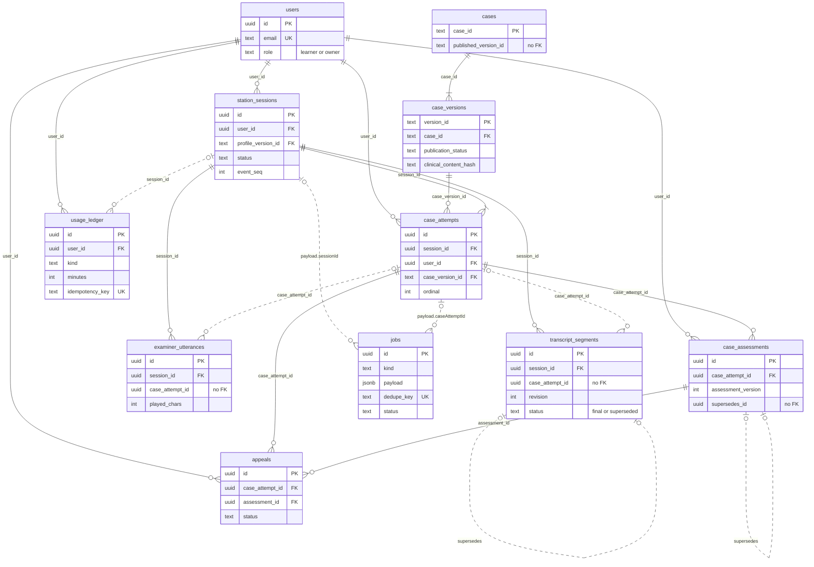

# Data model

The system stores its durable state in PostgreSQL: attempts, transcripts, assessments, usage
and payments. This document describes every table, the rules the database enforces, what is
versioned instead of overwritten, and what the privacy jobs delete and keep. It was written from
the code. Where this document and the code disagree, the code is correct.

- Schema: `packages/db/src/schema.ts` (Drizzle ORM). Column names are snake_case in the database
  and camelCase in TypeScript.
- Migrations: `packages/db/migrations/*.sql`, applied in journal order by `pnpm db:migrate`
  (Drizzle migrator).
- Durable events and the job queue built on these tables are described in
  [EVENTS.md](EVENTS.md). The HTTP routes that read and write them are in [API.md](API.md).

## Migrations

| File | Content |
|---|---|
| `0000_init.sql` | All 37 tables, foreign keys and indexes. |
| `0001_security_policies.sql` | Row-level security on every table, privilege revocation for Supabase API roles, and the triggers on `session_events`, `usage_ledger`, `transcript_segments`, `case_assessments` and `jobs`. |
| `0002_learning_plan_assignments.sql` | Adds `learning_plans.assignments`. |
| `0003_attempt_version_binding.sql` | Adds the trigger that keeps a case attempt bound to its case version, session and position. |
| `0004_plan_pace_and_item_states.sql` | Adds `learning_plans.item_states` and `users.plan_pace`. |

## Conventions

- Primary keys are UUIDs generated by `gen_random_uuid()`, except where a table lists another key.
  Content versions, cases, profile versions, viewer commands, media handles, Stripe events and
  configuration keys use text keys. `entitlements` is keyed by `user_id`. `processed_commands`
  has a composite key.
- Timestamps are `timestamptz`. `created_at` defaults to `now()`.
- Status and kind columns are `text`. Their allowed values come from TypeScript types and Zod
  contracts. The database has no CHECK constraints for them.
- JSON columns are `jsonb`. Their shapes are defined in `packages/contracts`.
- Every foreign key uses the default `ON DELETE NO ACTION`. Some reference columns have no
  foreign key; they are marked "no FK" below.
- Learner data is linked to the user directly (`user_id`) or through the session
  (`station_sessions.user_id`). The API scopes every learner query by the authenticated user;
  the owner role can read across users.

## Tables

### Identity, auth and consent

#### `users`

One row per account, learner or owner, local or Supabase.

- Key columns:
  - `id` (PK).
  - `email`: stored in lower case by the application.
  - `display_name`.
  - `role`: `learner` (default) or `owner`.
  - `auth_provider`: `local` or `supabase`. `external_auth_id`: the Supabase `sub`.
  - `password_hash`: scrypt, local accounts only.
  - `totp_secret`: AES-256-GCM envelope (`v1.<iv>.<tag>.<ciphertext>`). `totp_enabled`.
  - `stripe_customer_id`.
  - `plan_pace`: `compressed`, `standard` (default) or `relaxed`. Added in 0004.
  - `created_at`, `deleted_at` (set by account deletion).
- Unique: `users_email_uq (email)`, `users_external_auth_uq (auth_provider, external_auth_id)`,
  `users_stripe_customer_uq (stripe_customer_id)`. PostgreSQL unique indexes allow several NULLs.
- Referenced by: most learner-owned tables through `user_id`.
- A deleted account keeps its row in anonymized form (see [Privacy jobs](#privacy-jobs)).

#### `auth_sessions`

Local sign-in sessions behind the `sim_session` cookie.

- Key columns: `id` (PK), `user_id` → `users`, `token_hash` (SHA-256 of the cookie token),
  `expires_at`, `last_seen_at` (set at creation; the current code never updates it),
  `mfa_verified_at` (TOTP verified for this sign-in), `revoked_at`.
- Unique: `auth_sessions_token_uq (token_hash)`. Index: `(user_id)`.

#### `consents`

Consent records. The newest row per user and kind is the current state.

- Key columns: `id` (PK), `user_id` → `users`, `kind` (`terms`, `privacy`,
  `microphone_processing`, `audio_retention`, `browser_speech_vendor`, `evaluation_use`),
  `granted`, `policy_version`, `created_at`.
- Index: `(user_id, kind, created_at)`.
- The code only inserts rows. No trigger enforces this. A consent counts only when its
  `policy_version` equals `POLICY_VERSION` in `apps/api/src/policy.ts`.

### Content

#### `exam_profiles`

Examination profile versions: board format, station timing, prompting and scoring rules.

- Key columns: `version_id` (text PK, for example `abr-dr-neuro-oral@2026-11-15.1`),
  `profile_id`, `payload` (`ExamProfileVersion`), `active` (default true), `created_at`.
- Referenced by: `exam_forms.profile_version_id`, `station_sessions.profile_version_id`.
- Owner verification inserts a new version and sets the old one inactive. `GET /api/profiles`
  lists active versions. The development seed (refused in production) upserts the payloads of
  the built-in versions.

#### `cases`

One row per case. The id stays the same across versions.

- Key columns: `case_id` (text PK, a slug), `case_family_id`, `published_version_id` (no FK),
  `withdrawn_at`, `withdrawal_reason`, `created_at`.
- Referenced by: `case_versions.case_id`.

#### `case_versions`

Each version of a case: the full content, its workflow status, content hashes and validation
results.

- Key columns:
  - `version_id` (text PK, `<caseId>@v<n>`), `case_id` → `cases`, `version_number`.
  - `payload` (`CaseVersion`): stages, questions, fact replies, rubric, clinical truth, assets
    with storage keys, approval and clearances. Owner-only material; candidates see projections.
  - `publication_status`: `draft`, `automated_checks`, `ready_for_owner`, `owner_approved`,
    `published` or `retired`.
  - `clinical_content_hash`, `rubric_hash`, `assets_hash`: SHA-256 hex
    (`packages/clinical-content/src/hash.ts`).
  - `is_fixture`, `validation_issues`, `created_by` (owner user id, or `seed`).
  - `created_at`, `updated_at`, `row_version` (optimistic concurrency for draft saves).
- Unique: `case_versions_case_number_uq (case_id, version_number)`.
  Index: `(publication_status)`.
- Referenced by: `case_attempts.case_version_id`, `case_reviews.case_version_id`;
  `asset_handles.case_version_id` (no FK).

#### `case_reviews`

Results of automated checks, LLM critiques and LLM authoring runs on a version.

- Key columns: `id` (PK), `case_version_id` → `case_versions`, `reviewer`
  (`automated_checks`, `clinical_critic`, `rubric_critic`, `case_author`, `owner`), `status`
  (`pending`, `complete`, `failed`, `unavailable`), `issues`, `summary`, `provenance`,
  `created_at`.
- Index: `(case_version_id)`. The code only inserts rows.

#### `source_files`

Registry of quarantined source files: `label`, `kind`, `sha256`, `quarantine_storage_key`,
`privacy_status`, `rights_status`, `notes`, `created_by` → `users`. Defined in the schema, but no
code in this repository reads or writes it. The ingestion tool in `tools/ingestion` works on
files and produces import packages; it does not write to the database.

#### `source_inventory_items`

Inventory of source material: `locator`, `case_family_id`, `source_diagnosis`,
`diagnosis_basis`, `modalities`, identifier findings, commercial-use status, missing material;
`source_file_id` → `source_files`. No code reads or writes it.

#### `content_requests`

Requests for missing cases. Missing content is recorded as a request, never as an invented case.
The development seed creates ten slots.

- Key columns: `id` (PK), `slot`, `title`, `description`, `categories`, `status` (`open`,
  `in_progress`, `fulfilled`, `withdrawn`), `case_id` (no FK), `created_at`.
- No unique constraint on `slot`; the seed checks before inserting.

### Attempts and the live session

#### `exam_forms`

The ordered list of case versions assembled for a session.

- Key columns: `id` (PK), `profile_version_id` → `exam_profiles`, `mode`, `case_version_ids`
  (array in order), `seed`, `notes`, `created_at`.
- Referenced by: `station_sessions.form_id`.
- `seed` stores the user id only. The seed passed to form assembly also contains a timestamp, so
  the stored value cannot reproduce the form.

#### `station_sessions`

One station: mode, status, clock, speech settings and counters.

- Key columns:
  - `id` (PK), `user_id` → `users`, `profile_version_id` → `exam_profiles`,
    `form_id` → `exam_forms`.
  - `mode`: `exam`, `practice` or `owner_preview`.
  - `status`: `preflight`, `ready`, `active`, `technically_interrupted`, `finalizing`,
    `complete` or `aborted`.
  - `outcome`: `completed`, `time_expired`, `candidate_ended`, `user_aborted` or
    `invalidated_technical`.
  - `clock` (`ClockState`): duration, accumulated active milliseconds, start of the running
    segment, and the list of pauses with reasons.
  - `case_count`, `current_case_index`, `input_mode` (`voice` or `typed_practice`).
  - `speech_config`: `{ asr, tts, demo }`. `demo` marks the free demonstration.
  - `preflight` (the preflight report), `contains_fixtures`, `technical_notes` (strings).
  - `event_seq`: the last session event number. `viewer_seq`: the last viewer command number.
  - `row_version`: incremented on every save by the live controller, never checked.
  - `created_at`, `started_at`, `ended_at`, `finalized_at`.
- Index: `(user_id, created_at)`.
- Referenced by (FK): `case_attempts`, `asset_handles`, `session_events`,
  `processed_commands`, `transcript_segments`, `examiner_utterances`, `viewer_commands`,
  `session_debriefs`, `recordings`. Without FK: `usage_ledger.session_id`,
  `model_calls.session_id`, `metric_samples.session_id`, `skill_observations.session_id`.

#### `case_attempts`

One case inside a session, bound to one case version.

- Key columns:
  - `id` (PK), `session_id` → `station_sessions`, `user_id` → `users`,
    `case_version_id` → `case_versions`, `case_family_id`.
  - `ordinal`: 0-based position in the session.
  - `status`: `pending`, `active` or `closed`.
  - `stage_state` (`StageState`): current stage, revealed stages, delivered questions and fact
    replies, probes per element, first render time or failure per asset.
  - `started_at_ms`, `ended_at_ms`: session clock milliseconds.
  - `close_reason`: `examiner_completed`, `time_expired`, `candidate_requested`,
    `station_ended` or `technical_failure`.
  - `first_exposure`: true when the user had no earlier closed attempt in the same case family.
- Unique: `case_attempts_session_ordinal_uq (session_id, ordinal)`. Index: `(user_id)`.
- Trigger `case_attempts_binding_immutable` (0003): `case_version_id`, `session_id` and
  `ordinal` cannot change.
- Referenced by (FK): `asset_handles`, `assessment_passes`, `case_assessments`, `appeals`.
  Without FK: `case_attempt_id` in `session_events`, `transcript_segments`,
  `examiner_utterances`, `viewer_commands`, `skill_observations` and `model_calls`.

#### `asset_handles`

Opaque per-attempt media handles. Every media request is authorized against this table.

- Key columns: `handle` (text PK, `h_` + 32 hex characters), `user_id` → `users`,
  `session_id` → `station_sessions`, `case_attempt_id` → `case_attempts`, `case_version_id`
  (no FK), `asset_id` (the authored asset id), `disclosed_at`, `revoked_at` (set when the case is
  withdrawn).
- Unique: `asset_handles_attempt_asset_uq (case_attempt_id, asset_id)`.

#### `session_events`

The append-only log of a session. Event types and payloads are listed in
[EVENTS.md](EVENTS.md#2-durable-session-events).

- Key columns: `id` (PK), `session_id` → `station_sessions`, `case_attempt_id` (no FK), `seq`,
  `server_time`, `session_clock_ms`, `type`, `payload_schema_version` (default 1), `payload`,
  `content_versions`.
- Unique: `session_events_seq_uq (session_id, seq)`. Index: `(session_id, type)`.
- Trigger `session_events_no_update`.

#### `processed_commands`

WebSocket command ids already applied. Used to ignore retries and duplicates after reconnects.

- Key columns: `session_id` → `station_sessions`, `command_id`, `result` (always `{ ok: true }`
  in the current code), `created_at`.
- Primary key: `(session_id, command_id)`.

#### `transcript_segments`

Candidate speech or typed text, with times assigned by the server. Corrections are new rows.

- Key columns:
  - `id` (PK), `session_id` → `station_sessions`, `case_attempt_id` (no FK).
  - `source`: `server_asr`, `client_asr`, `typed` or `dev_injected`.
  - `text`, `start_ms`, `end_ms` (session clock), `words` (word timings or null), `confidence`
    (provider value or null), `provider` (`{ name, model, requestId }`; `owner_correction` for
    owner revisions).
  - `revision` (0 for the original), `supersedes_segment_id` (no FK), `status` (`final` or
    `superseded`), `revision_reason`, `revised_by` (no FK), `created_at`.
- Index: `(session_id, start_ms)`.
- Trigger `transcript_segments_immutable`.

#### `examiner_utterances`

Every examiner prompt: what was planned and how much of it was played.

- Key columns:
  - `id` (PK), `session_id` → `station_sessions`, `case_attempt_id` (no FK).
  - `kind`, `ref_id` (question, fact reply, neutral phrase or hint id), `prompt_class`, `text`,
    `target_element_ids`, `supplies_element_ids`.
  - `planned_at_ms`, `playback_started_at_ms`, `playback_ended_at_ms` (session clock).
  - `played_chars`, `played_portion_method` (`provider_alignment`, `browser_boundary`,
    `proportional_estimate`, `completed` or `none`).
  - `delivery_status` (`planned`, `playing`, `completed`, `interrupted`, `failed`,
    `cancelled`), `tts_provider`, `created_at`.
- Index: `(session_id, planned_at_ms)`.
- `text` is the full intended text. What the candidate heard is the first `played_chars`
  characters. Playback columns are updated in place. The code never sets `cancelled`.

#### `viewer_commands`

Every viewer command sent to the browser, with its acknowledgement.

- Key columns: `id` (text PK, the command UUID), `session_id` → `station_sessions`,
  `case_attempt_id` (no FK), `seq`, `kind`, `payload` (`ViewerCommand`), `await_ack`, `status`
  (`sent`, `rendered`, `failed`, `superseded`, `deferred`), `created_at`, `acked_at`.
- Unique: `viewer_commands_seq_uq (session_id, seq)`.
- The code never writes `deferred`; a deferred acknowledgement only extends the wait.

### Job queue

#### `jobs`

The durable background job queue ([EVENTS.md](EVENTS.md#3-background-jobs)).

- Key columns: `id` (PK), `kind`, `payload`, `status` (`queued`, `running`, `succeeded`,
  `dead`), `attempts`, `max_attempts` (default 5), `run_at`, `locked_at`, `locked_by`,
  `last_error` (redacted, at most 500 characters), `dedupe_key`, `result`, `created_at`,
  `updated_at`.
- Unique: `jobs_dedupe_uq (dedupe_key)`. Index: `(status, run_at)`.
- Trigger `jobs_notify`.
- Ids inside `payload` (attempt, session, case version, user, data request, Stripe event) are not
  foreign keys.

### Assessment, feedback, appeals and learning

#### `assessment_passes`

Each step of the assessment pipeline for an attempt.

- Key columns: `id` (PK), `case_attempt_id` → `case_attempts`, `stage` (`extraction`, `A`,
  `B`, `adjudication`, `feedback`), `run` (default 1; the worker does not set it),
  `assessor_kind` (`llm`, `dev_baseline`, `mock`), `provenance`, `input_hash`, `output`,
  `validation_issues`, `status` (`valid`, `repaired`, `invalid`, `unavailable`), `latency_ms`,
  `created_at`.
- Unique: `assessment_passes_uq (case_attempt_id, stage, run, input_hash)`. Inserts use
  `ON CONFLICT DO NOTHING`, so rerunning a step on identical inputs adds no row.

#### `case_assessments`

The final assessment of an attempt, one row per version.

- Key columns: `id` (PK), `case_attempt_id` → `case_attempts`, `user_id` → `users`,
  `assessment_version` (1, 2, …), `payload` (`FinalCaseAssessment`: element results with
  evidence, global rating, caps, disputed elements, provenance), `provisional`, `withheld` (no
  global level), `assessor_kind`, `supersedes_id` (no FK), `created_at`.
- Unique: `case_assessments_version_uq (case_attempt_id, assessment_version)`.
- Trigger `case_assessments_no_update`.
- Referenced by: `appeals.assessment_id`.

#### `session_debriefs`

The learner-facing debrief of a session, one row per version.

- Key columns: `id` (PK), `session_id` → `station_sessions`, `user_id` → `users`, `version`,
  `payload` (`SessionDebrief`), `created_at`.
- Unique: `session_debriefs_version_uq (session_id, version)`. The API returns the highest
  version.

#### `skill_observations`

One row per rubric element and skill from an assessment. Progress trends and learning plans are
computed from these rows.

- Key columns: `id` (PK), `user_id` → `users`; `session_id`, `case_attempt_id`,
  `assessment_id` (no FKs); `mode`, `profile_version_id`, `case_family_id`, `element_id`,
  `skill`, `severity`, `status`, `prompting_level`, `first_exposure`, `assisted` (prompted beyond
  spontaneous), `is_fixture`, `superseded` (default false), `created_at`.
- Index: `(user_id, skill, created_at)`.
- A new assessment of an attempt marks that attempt's earlier rows superseded and inserts new
  rows. Owner previews produce none.

#### `learning_plans`

Generated learning plans. The newest row whose `superseded_at` is null is the current plan.

- Key columns:
  - `id` (PK), `user_id` → `users`, `payload` (`LearningPlan`).
  - `assignments`: map of opaque assignment token to case id. Server-only. Added in 0002.
  - `item_states`: map of plan item id to `suggested`, `started`, `completed` or `skipped`.
    Added in 0004.
  - `created_at`, `superseded_at`.
- `payload` is never edited after insert. Learner progress is kept in `item_states` and the
  pace in `users.plan_pace`; both are applied when the plan is read
  (`GET /api/learning/plan`). A new plan starts with empty `item_states`.
- No constraint guarantees a single current plan per user.

#### `appeals`

Learner disputes of a transcript or a grading decision.

- Key columns: `id` (PK), `user_id` → `users`, `case_attempt_id` → `case_attempts`,
  `assessment_id` → `case_assessments`, `kind` (`transcript` or `grading`), `statement`,
  `disputed_element_ids`, `transcript_corrections` (`[{ segmentId, proposedText }]`), `status`
  (`submitted`, `under_review`, `upheld`, `revised`, `rejected`), `resolution`,
  `revised_assessment_id` (never set by the current code), `created_at`, `resolved_at`.
- Index: `(user_id)`.

#### `owner_review_items`

The owner's exception queue.

- Key columns: `id` (PK), `kind`, `priority` (`urgent`, `normal`, `digest`), `status` (`open`,
  `resolved`, `dismissed`), `title`, `detail`, `refs` (string map such as `caseAttemptId`,
  `sessionId`, `versionId`, `jobId`), `dedupe_key`, `resolution`, `resolved_by` (no FK),
  `created_at`, `resolved_at`.
- Unique: `owner_review_items_dedupe_uq (dedupe_key)`. Index: `(status, priority)`.
- Kinds (`OwnerReviewKind` in `packages/contracts/src/assessment.ts`):
  `assessment_disagreement`, `uncertain_finding`, `consequential_grading_risk`,
  `rights_privacy_concern`, `learner_appeal`, `changed_clinical_content` (declared, not
  produced), `case_ready_for_approval`, `technical_failure_adjustment`.
- Dedupe key patterns by producer:

| Producer | Dedupe key |
|---|---|
| Learner appeal | `appeal:<appealId>` |
| Case withdrawal | `withdrawn:<caseId>:<epoch ms>` |
| Station ended by technical invalidation | `invalidated:<sessionId>` |
| Dead-lettered job | `dead-job:<jobId>` |
| Stripe dispute or refund | `stripe-review:<eventId>` |
| Automated checks passed | `ready:<versionId>:<first 12 hex of clinical hash>` |
| Critic raised blocking issues | `critic:<focus>:<versionId>:<epoch ms>` |
| Assessment pipeline | `disagreement:<attemptId>:<elementId>`, `global-disagreement:<attemptId>`, `assessment-unavailable:<attemptId>`, `single-pass:<attemptId>`, `unsafe:<attemptId>:…`, `unsafe-disputed:<attemptId>:…`, `uncertain:<attemptId>` |

### Billing

#### `subscriptions`

A copy of each Stripe subscription.

- Key columns: `id` (PK), `user_id` → `users`, `stripe_subscription_id`,
  `stripe_customer_id`, `plan_id`, `status` (Stripe's status), `current_period_start`,
  `current_period_end`, `cancel_at_period_end`, `trial_end`, `last_event_created` (Stripe
  `created` time of the newest applied event; guards against out-of-order delivery),
  `updated_at`.
- Unique: `subscriptions_stripe_uq (stripe_subscription_id)`.

#### `entitlements`

Per-user entitlement state that decides whether paid stations can start, plus the demo
allowance.

- Key columns: `user_id` (PK, FK → `users`), `status` (`none` (default), `demo`, `trialing`,
  `active`, `past_due`, `canceled_pending_period_end`, `canceled`, `suspended`), `plan_id`,
  `period_key`, `period_end`, `demo_cases_remaining` (default 1), `row_version` (never
  incremented), `updated_at`.
- Rows are created on demand (`INSERT ... ON CONFLICT DO NOTHING`) and locked with
  `SELECT ... FOR UPDATE` during reservations, allotments and demo consumption.

#### `usage_ledger`

Immutable, signed minute entries. A user's available balance is the sum of `minutes`.

- Key columns: `id` (PK), `user_id` → `users`, `kind`, `minutes`, `session_id` (no FK),
  `period_key`, `idempotency_key`, `reason`, `actor` (`system`, `stripe`, `seed` or an owner
  user id), `created_at`.
- Unique: `usage_ledger_idem_uq (idempotency_key)`. Index: `(user_id, created_at)`.
- Trigger `usage_ledger_immutable`.

| Kind | Sign | Idempotency key | Written when |
|---|---|---|---|
| `allot` | + | `allot:<periodKey>` | A paid or trialing Stripe period starts (period key `<subscriptionId>:<period start>`), or the development seed runs (`dev-allotment:<userId>`). |
| `expire` | − | `expire-before:<periodKey>` | Just before a new allotment, for any positive leftover balance. |
| `reserve` | − | `reserve:<sessionId>` | A billed station starts. |
| `release` | + | `release:<sessionId>` | The station ends: the whole reservation is returned. |
| `consume` | − | `consume:<sessionId>` | The station ends: active minutes used, rounded up, at most the reservation. |
| `adjust` | ± | `adjust:platform-failure:<sessionId>` | A station invalidated after a platform failure: consumed minutes credited back. |
| `adjust` | ± | `adjust:owner:<uuid>` | Owner adjustment. |

#### `stripe_events`

Every verified Stripe webhook event, stored before it is processed.

- Key columns: `id` (text PK, the Stripe event id), `type`, `api_version`, `created` (Stripe
  epoch seconds), `livemode`, `payload` (the full event), `status` (`pending`, `processed`,
  `ignored`, `failed`), `attempts`, `last_error`, `received_at`, `processed_at`.
- The code never writes `failed` or `last_error`. A failed processing attempt rolls back, so the
  row stays `pending` while the job retries.

### Privacy, operations and audit

#### `recordings`

Retained learner audio, for users who consented to audio retention.

- Key columns: `id` (PK), `user_id` → `users`, `session_id` → `station_sessions`,
  `storage_key` (bucket `recordings`), `bytes`, `retained_until`, `deleted_at`, `created_at`.
- No code in this repository inserts rows. The worker setting `RECORDING_RETENTION_DAYS` is read
  but not used.

#### `data_requests`

Learner export and deletion requests.

- Key columns: `id` (PK), `user_id` → `users`, `kind` (`export` or `deletion`), `status`
  (`requested`, `processing`, `complete`, `failed`), `result_storage_key` (export file in bucket
  `exports`; cleared when the file is deleted), `created_at`, `completed_at`.
- The code never writes `failed`. If the job dead-letters, the request stays `processing`.

#### `model_calls`

Telemetry for every model call: `role`, `provider`, `model`, `prompt_id`, `prompt_version`,
`status` (`ok`, `invalid_output`, `timeout`, `provider_error`, `refused`, `budget_exceeded`,
`disabled`), `error_class`, `latency_ms`, token counts, `estimated_cost_usd`, and optional
`session_id`, `case_attempt_id`, `case_version_id` (no FKs). No prompt or response text is
stored. Indexes: `(role, created_at)`, `(session_id)`.

#### `metric_samples`

Named numeric samples with labels and an optional `session_id`. Index: `(name, created_at)`.
`GET /api/owner/metrics` reads it; no code writes it.

#### `audit_events`

Audit trail of security and governance actions, without clinical text or credentials.

- Key columns: `id` (PK), `actor_user_id` (no FK), `action`, `target_type`, `target_id` (text),
  `detail`, `created_at`.
- Index: `(target_type, target_id)`.
- The actions written are listed in [EVENTS.md](EVENTS.md#25-related-durable-records).

#### `system_config`

Owner-controlled runtime configuration.

- Key columns: `key` (text PK), `value`, `updated_by` (no FK), `updated_at`.
- Keys used: `switches` (kill switches for model roles, server speech and cases),
  `assessment_policy` (second-pass policy), `demo_case_ids` (cases for the free demonstration).

## Rules enforced by the database

### Triggers

| Trigger | Table | Fires | Effect | Migration |
|---|---|---|---|---|
| `session_events_no_update` | `session_events` | `BEFORE UPDATE`, each row | Raises `<table> is append-only (UPDATE not permitted)`. | 0001 |
| `usage_ledger_immutable` | `usage_ledger` | `BEFORE UPDATE OR DELETE`, each row | Raises `<table> is immutable (<op> not permitted)`. | 0001 |
| `transcript_segments_immutable` | `transcript_segments` | `BEFORE UPDATE`, each row | Raises if `text`, `start_ms`, `end_ms`, `source`, `provider` or `words` change. Other columns, such as `status` and `confidence`, may change. | 0001 |
| `case_assessments_no_update` | `case_assessments` | `BEFORE UPDATE`, each row | Raises `<table> is append-only (UPDATE not permitted)`. | 0001 |
| `jobs_notify` | `jobs` | `AFTER INSERT`, each row | `pg_notify('jobs_queued', kind)`, delivered at commit. | 0001 |
| `case_attempts_binding_immutable` | `case_attempts` | `BEFORE UPDATE`, each row | Raises if `case_version_id`, `session_id` or `ordinal` change. | 0003 |

Limits:

- `DELETE` is allowed on `session_events`, `transcript_segments` and `case_assessments`. The data
  deletion job uses it.
- Row triggers do not fire on `TRUNCATE`, and a table owner can disable triggers.
- `case_versions` and `exam_profiles` have no immutability trigger. Their versioning is enforced
  by application code (next section).

### Row-level security

Migration 0001:

- enables row-level security on every table in schema `public` that exists at that point (all 37
  tables), and creates no policies;
- if the Supabase roles `anon` and `authenticated` exist, revokes all their table privileges and
  changes default privileges so that future tables are not granted to them.

The effect is deny-by-default for Supabase's API roles, even if its REST endpoint is exposed. The
application connects as the table owner. Row-level security does not apply to the owner unless
`FORCE ROW LEVEL SECURITY` is set, and it is not set, so all authorization happens in the API.
Migrations 0002 to 0004 add no tables. A table added later needs row-level security enabled in
its own migration.

## Versioned rather than overwritten

| Data | How a change is stored | Enforced by |
|---|---|---|
| Case content | A revision is a new `case_versions` row (`<caseId>@v<n+1>`, `previousVersionId` in the payload). Drafts are edited in place, guarded by `row_version`. Other statuses change only through workflow transitions, clearance updates (governance fields outside the clinical hash) and the automated-checks job. Owner approval stores the three content hashes, and publication requires them to still match. | Application code. The attempt trigger (0003) keeps each attempt on the version it started with. |
| Exam profiles | Owner verification inserts a new `exam_profiles` row (`<profileId>@<YYYY-MM-DD>.<n>`) and sets the old one inactive. Sessions keep their profile version through a foreign key. | Application code. |
| Assessments | Every assessment, reassessment and owner decision inserts a new `case_assessments` version. `supersedes_id` points to the previous one. Readers use the highest version. | Trigger `case_assessments_no_update` and the unique version index. |
| Assessment passes | Insert only; one row per step and input hash. | Unique index. |
| Transcript revisions | An owner correction inserts a new segment (`revision + 1`, `supersedes_segment_id`, provider `owner_correction`, `revised_by`, `revision_reason`) and marks the original `superseded`. Learner views and assessment read `final` segments only. | Trigger `transcript_segments_immutable`. |
| Debriefs | Each build inserts a new `session_debriefs` version. | Unique version index. |
| Skill observations | Earlier rows are flagged `superseded`; new rows are inserted. | Application code. |
| Learning plans | Each plan update inserts a new row and sets `superseded_at` on the old one. The plan payload is never edited; item progress (`item_states`) and pace (`users.plan_pace`) are separate and updated in place. | Application code. |
| Usage | Ledger entries are never changed or removed. Corrections are new `adjust` entries. Reservations are reconciled with `release` and `consume` entries. | Trigger `usage_ledger_immutable` and unique idempotency keys. |
| Consents | Each grant or withdrawal is a new row; the newest wins. | Application code. |
| Session events | Append only. | Trigger `session_events_no_update`. |

Updated in place: `users`, `auth_sessions`, `cases`, `station_sessions`, `case_attempts`
(status, stage state, timing), `examiner_utterances` (playback fields), `viewer_commands`
(acknowledgement), `owner_review_items`, `appeals`, `subscriptions`, `entitlements`,
`stripe_events` (status), `jobs`, `data_requests`, `content_requests`, `system_config`.

## Privacy jobs

The jobs are in `apps/worker/src/jobs/privacy.ts`. The API enqueues `data_export` and
`data_deletion` (see [API.md](API.md#account-consents-and-data-requests)). The worker enqueues
`retention_sweep`.

### `data_export`

1. Sets the request to `processing`.
2. Builds one JSON document with:
   - account: email, display name, creation time;
   - every consent record;
   - for each session: id, mode, profile version, status, outcome, creation time, the
     transcript (every segment row of the session, including superseded revisions: start time,
     text, source), the examiner lines as heard (played portion only) and a debrief (the last row
     the query returns; the query has no `ORDER BY`, so it is not guaranteed to be the newest
     version);
   - learning plan payloads, appeals (statement, status, resolution) and usage ledger entries
     (kind, minutes, time, reason).
3. Leaves out the private case bank: case content, rubrics, source images, assessment passes and
   owner review items.
4. Writes `exports/<userId>/<requestId>.json` to bucket `exports` and sets the request to
   `complete` with `result_storage_key` and `completed_at`.

### `data_deletion`

1. Deletes the user's recording files from storage (outside the database transaction).
2. In one transaction:
   - for owner review items whose `refs.caseAttemptId` is one of the user's attempts: replaces
     `detail` with `[redacted after learner data deletion]` and sets status `dismissed`;
   - for the user's attempts: deletes `appeals`, `skill_observations`, `assessment_passes` and
     `case_assessments`;
   - for the user's sessions: deletes `session_debriefs`, `transcript_segments`,
     `examiner_utterances`, `session_events`, `processed_commands`, `viewer_commands`,
     `asset_handles` and `recordings`;
   - clears `station_sessions.preflight` and `technical_notes`;
   - deletes the user's `learning_plans` (with their item progress);
   - revokes the user's `auth_sessions`;
   - anonymizes the `users` row: email becomes `deleted-<userId>@deleted.invalid`;
     `display_name`, `password_hash`, `totp_secret` and `external_auth_id` become null;
     `totp_enabled` becomes false; `deleted_at` is set;
   - sets the request to `complete`.

Kept after deletion:

| Data | What remains |
|---|---|
| `users` | The anonymized row, including `role`, `auth_provider`, `stripe_customer_id`, `plan_pace` and `created_at`. |
| `station_sessions`, `case_attempts`, `exam_forms` | Kept for usage reconciliation: mode, status, outcome, clock, profile and case version binding, stage state (authored ids and timings, no learner text). |
| `usage_ledger` | Kept; the trigger forbids deletion. |
| `entitlements`, `subscriptions` | Kept unchanged. |
| `consents`, `data_requests`, `auth_sessions` (revoked) | Kept. |
| `audit_events`, `model_calls`, `metric_samples` | Kept. They carry user, session or attempt ids but no transcript text. |
| `owner_review_items` not linked by `refs.caseAttemptId` | Kept unchanged, for example technical-invalidation items whose refs hold `sessionId` and `userId`. |
| `stripe_events` | Kept, with the full event payloads, which can include the customer's email and name. |
| Export files | Not deleted by this job. The retention sweep removes them. |

Because every foreign key is `ON DELETE NO ACTION` and the ledger cannot be deleted, the `users`
row cannot be removed; the job anonymizes it instead.

### `retention_sweep`

- Enqueued once when the worker process starts, with dedupe key `retention:<YYYY-MM-DD>` (UTC).
  Nothing else schedules it, so a worker that runs for several days sweeps only on the day it
  started.
- Deletes recording files whose `retained_until` has passed and sets `recordings.deleted_at`.
- For export requests whose `created_at` is older than the worker's `EXPORT_RETENTION_DAYS`
  (default 7): deletes the file and clears `result_storage_key`.
- Result: `{ recordingsDeleted, exportsDeleted }`. `exportsDeleted` counts every old export
  request, including those whose file was already removed.

The API reports `expiresAt` for a completed export as `completed_at` plus the API's own
`EXPORT_RETENTION_DAYS`. The sweep uses `created_at` and the worker's setting, and runs only as
described above.

## Entity-relationship diagram

Core entities only. Solid lines are foreign keys. Dashed lines are references without a foreign
key (an id column, or an id inside a job payload).

